# Architecture diagrams

All diagrams are [Mermaid](https://mermaid.js.org/) and render directly on GitHub. Component details are in [AGENTS.md](AGENTS.md),
the reasoning in [ARCHITECTURE.md](ARCHITECTURE.md), data definitions in [DESIGN_SPEC.md](DESIGN_SPEC.md).

Colour key used in the diagrams: **blue** = LLM involved, **green** = deterministic Python, **grey** = storage, **amber** = outside the system.

## 1. System context

Who and what talks to the app. Only the model provider is reached over the internet.

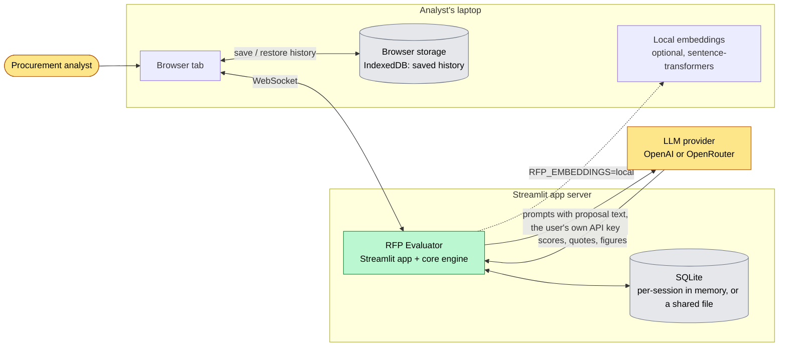

## 2. Layered architecture

Dependencies point downwards only. `core/` never imports Streamlit, so the whole engine runs and is tested without a UI.

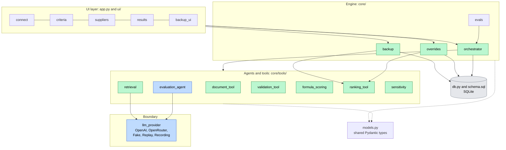

## 3. The agentic pipeline: what the model does and what Python does

The model is used in exactly two places. Everything after it is deterministic.

```mermaid
flowchart LR
    pdf["Supplier PDFs<br/>+ name, date, experience"] --> doc["Document Tool<br/>PyMuPDF text, sections"]
    doc --> mode{"Long<br/>document?"}
    mode -->|"no"| full["Evaluation Agent<br/>full context, one call"]
    mode -->|"yes"| ret["Retrieval Tool<br/>BM25 + embeddings"]
    ret --> evalr["Evaluation Agent<br/>one call per criterion"]
    doc --> facts["Fact Extraction Agent<br/>reads price and weeks only"]
    full --> val["Validation Tool<br/>schema, clip, verify quotes"]
    evalr --> val
    facts --> parse["Fact parser<br/>locale numbers, currency check"]
    val --> formula["Formula Scoring Tool<br/>figures to scores"]
    parse --> formula
    formula --> rank["Ranking Tool<br/>benchmark, gap, relative %, PPI,<br/>knock-outs, stable sort, tie-breaks"]
    rank --> sens["Sensitivity Tool<br/>weight robustness"]
    sens --> save[("Persist in one<br/>transaction")]
    save --> ui["Leaderboard, scorecards,<br/>JSON export"]
    ui --> ovr["Override Engine<br/>analyst changes, re-rank"]
    ovr --> save

    classDef llmc fill:#bfdbfe,stroke:#1d4ed8,color:#000
    classDef det fill:#bbf7d0,stroke:#15803d,color:#000
    classDef store fill:#e5e7eb,stroke:#6b7280,color:#000
    class full,evalr,facts llmc
    class doc,ret,val,parse,formula,rank,sens,ovr det
    class save store
```

## 4. One evaluation run, step by step

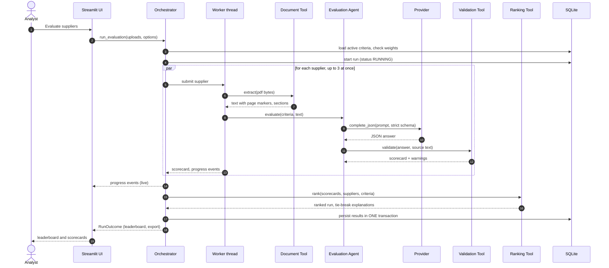

## 5. Evaluation Agent: choosing a mode and recovering from bad output

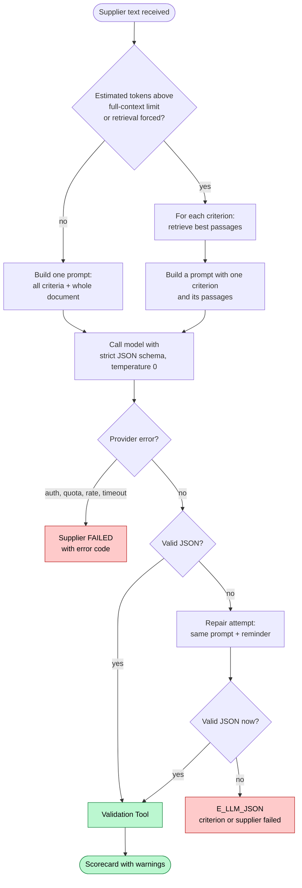

## 6. Long-document retrieval

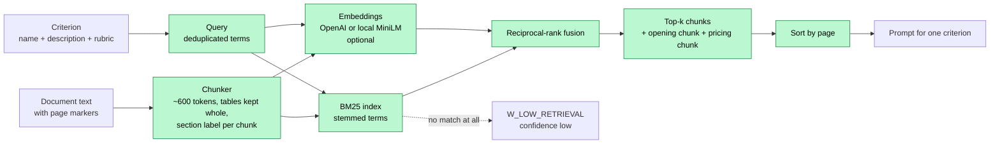

## 7. Ranking algorithm

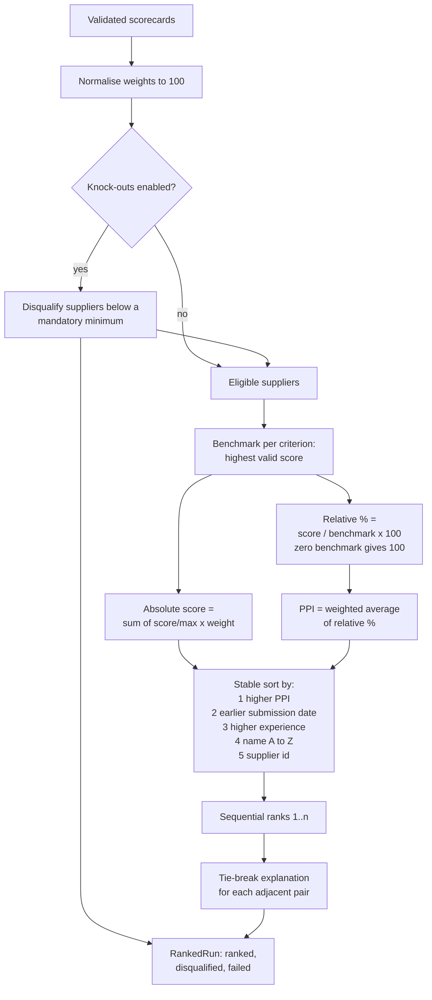

## 8. Data model

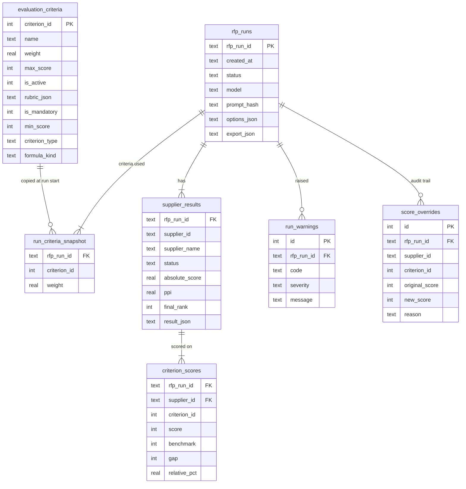

## 9. Status lifecycles

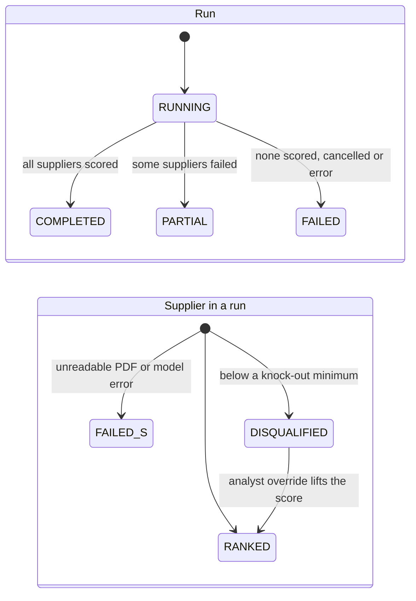

## 10. API key handling

The key exists only in the visitor's session memory.

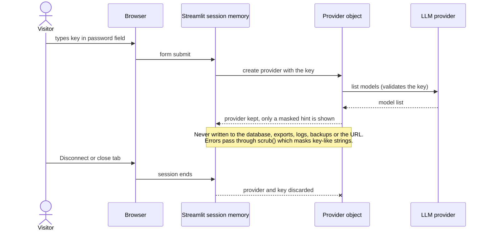

## 11. Where data lives: local versus hosted

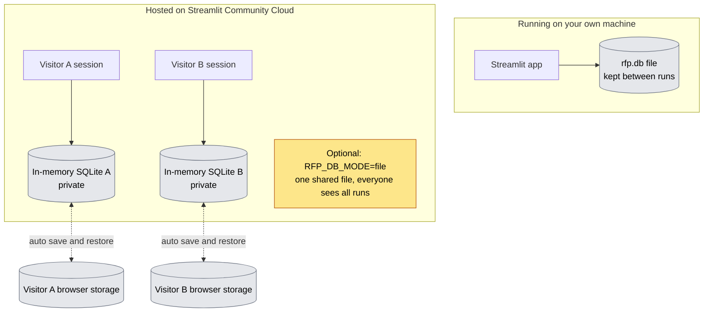

## 12. Backup and restore

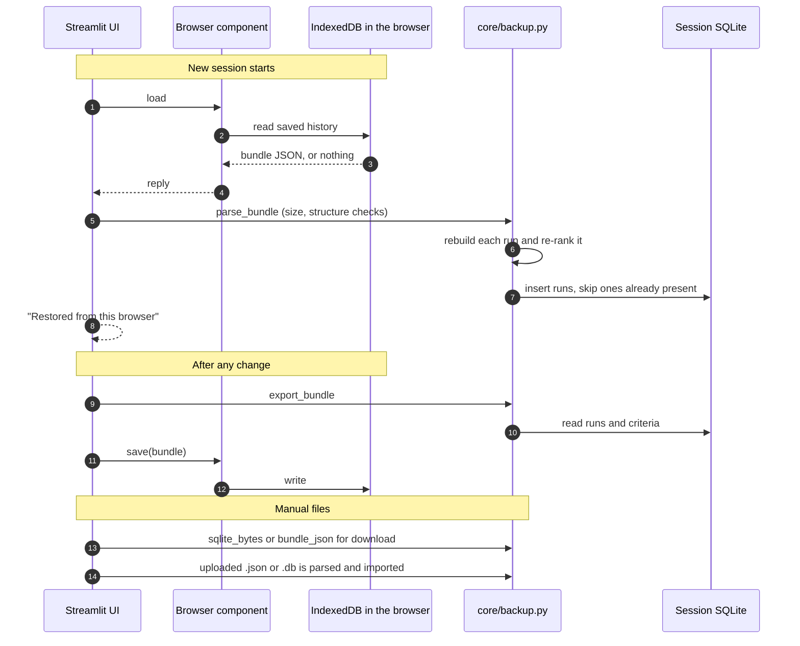

## 13. Analyst override

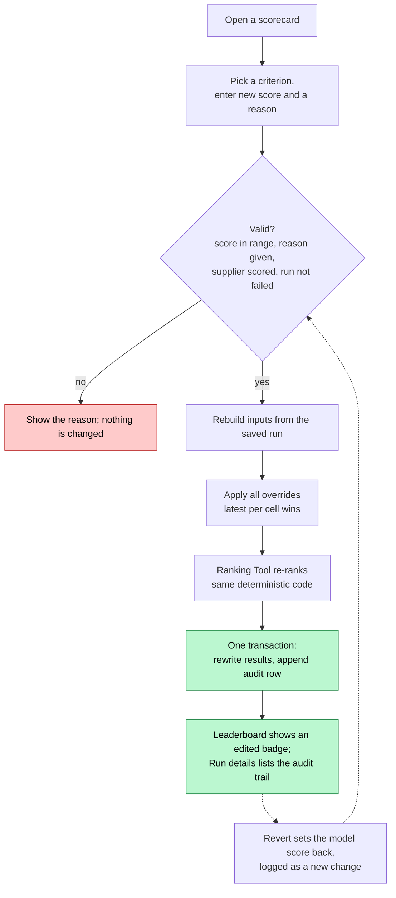

## 14. Screen navigation

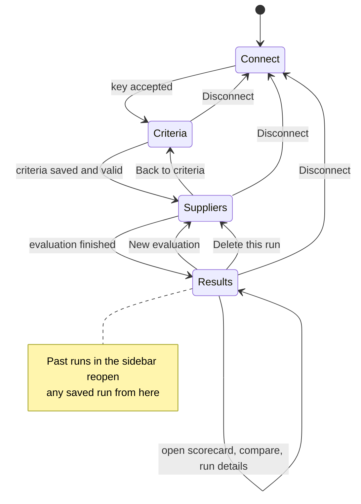

## 15. How the system is tested

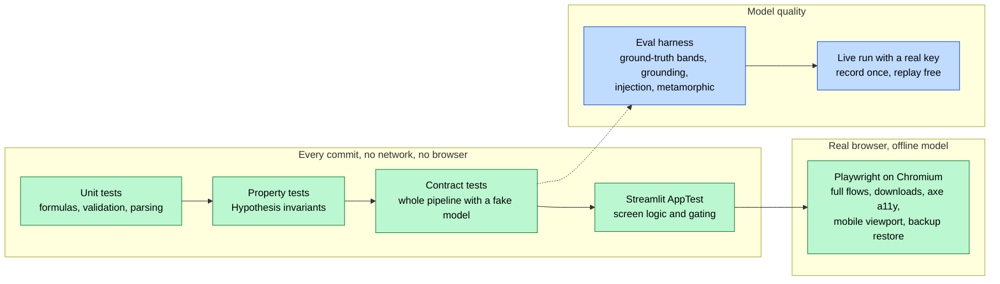
