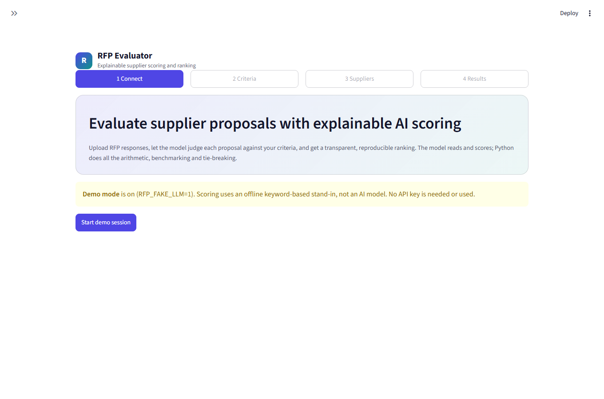
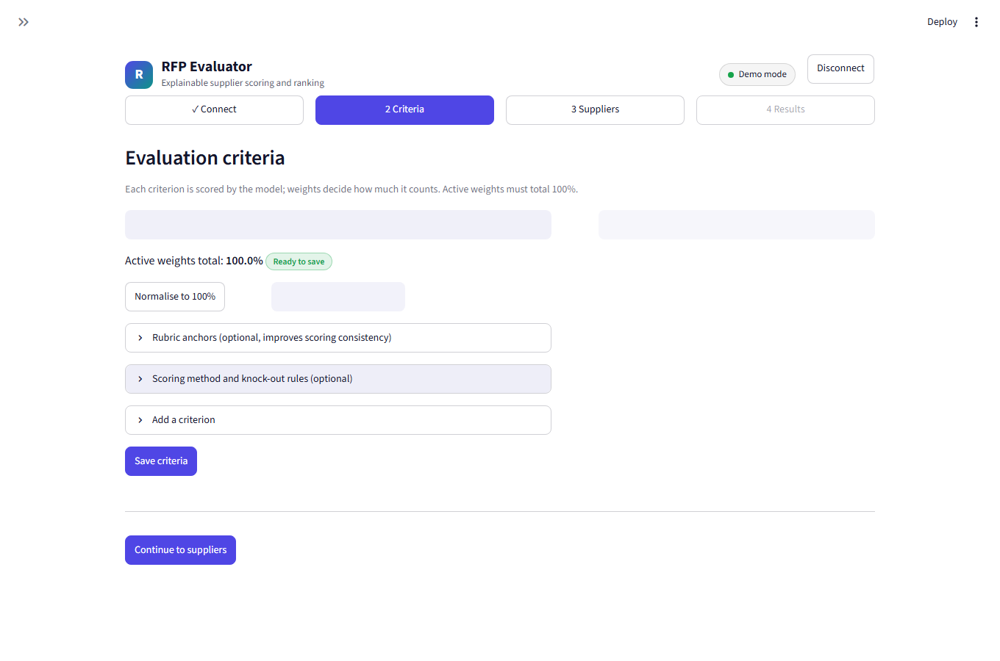
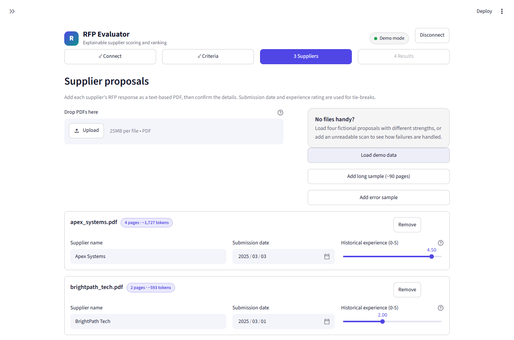
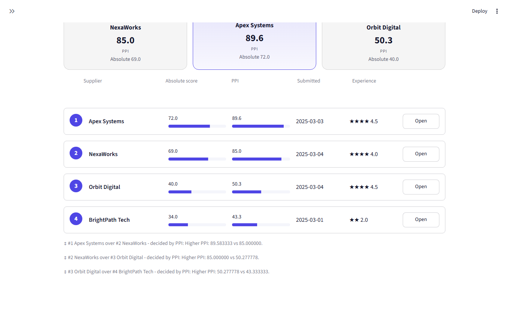
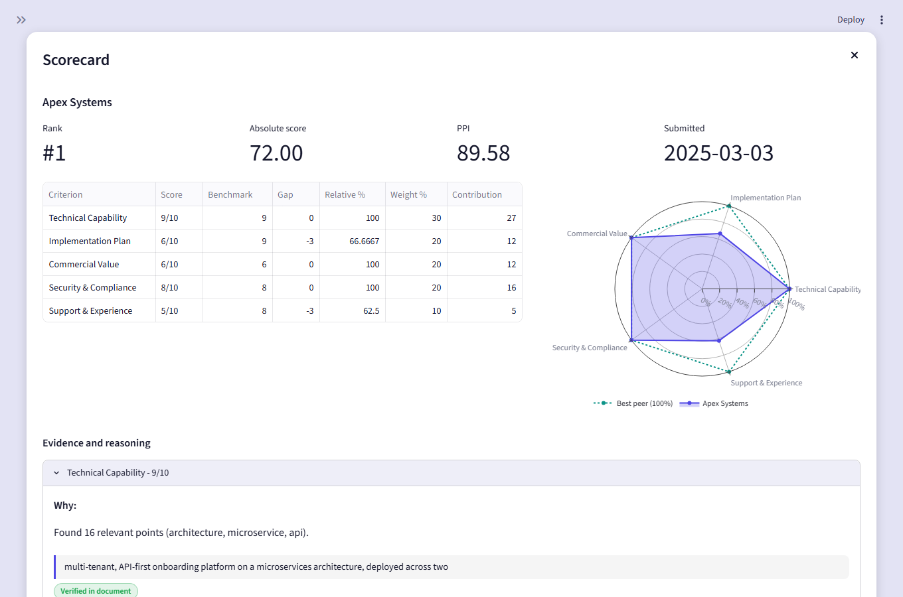
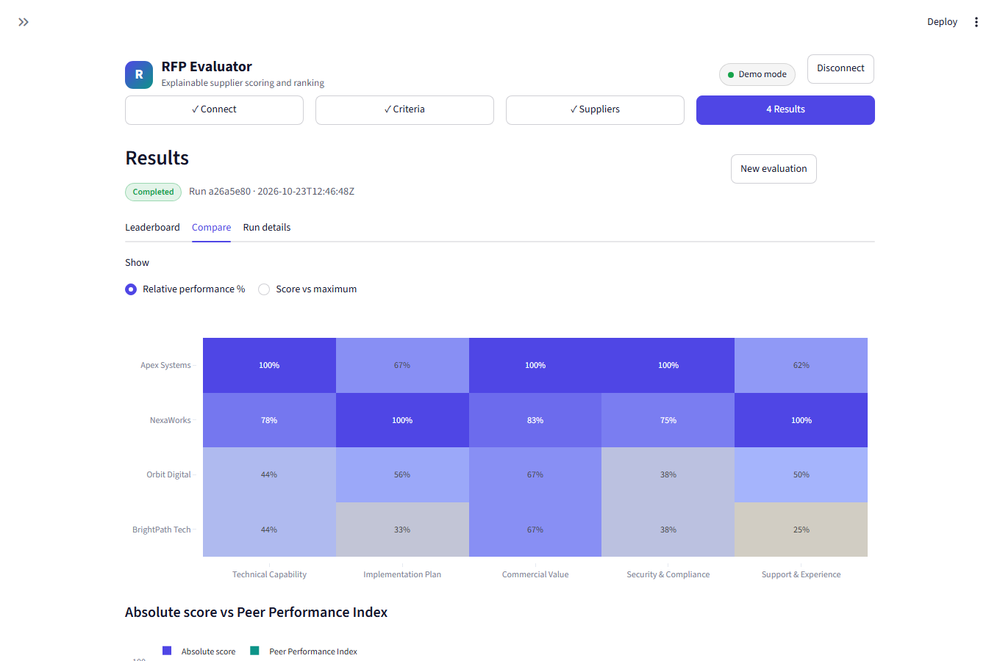
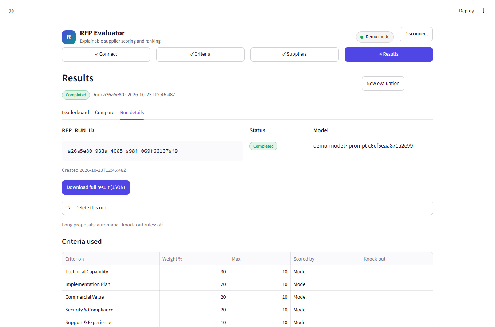
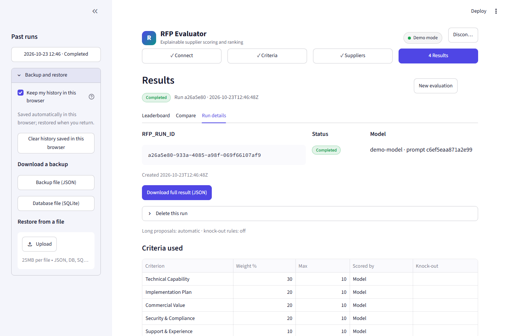
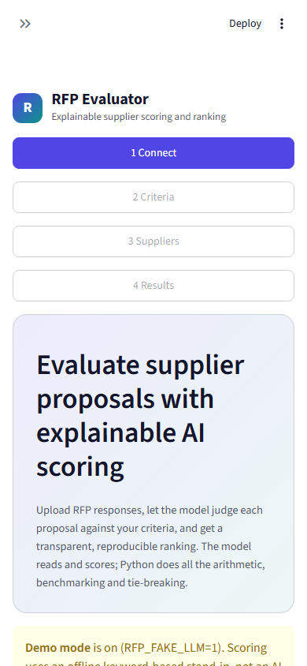
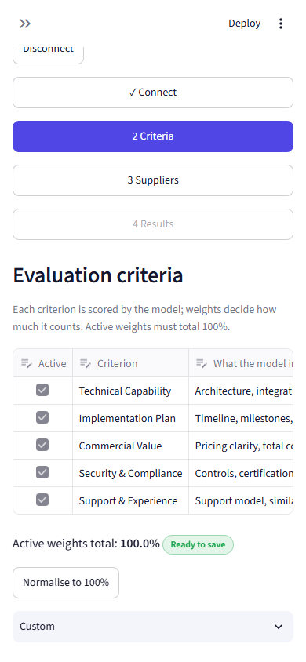

# UX and Visual Design

How the RFP Evaluator looks, behaves and communicates. Screenshots are captured from the running app in
offline demo mode (`python -m scripts.capture_screens`), so they can be regenerated whenever the UI changes.

Related: [ARCHITECTURE.md](ARCHITECTURE.md) · [DESIGN_SPEC.md](DESIGN_SPEC.md) · [DIAGRAMS.md](DIAGRAMS.md) · [AGENTS.md](AGENTS.md)

## 1. Design principles

1. **Explainable before impressive.** Every number links to its reason: score, evidence quote, benchmark, tie-break sentence.
2. **One path, four steps.** Connect, Criteria, Suppliers, Results. The stepper always shows where you are and what is done.
3. **Honest about the model.** Demo mode is labelled as a keyword stand-in. Warnings (`W_*`) and errors (`E_*`) show plain-language text, never raw tracebacks.
4. **Privacy by default.** The API key lives in session memory only; hosted data is in-memory per visitor; saving history to the browser is an explicit, visible toggle.
5. **Calm density.** Cards and whitespace for the leaderboard; tables for detail. Numbers use tabular figures so columns align.
6. **Never rely on colour alone.** Status pills carry text; ranks carry numbers; verified evidence carries a label.

## 2. Design tokens

Defined in `ui/theme.py` and `.streamlit/config.toml`.

| Token | Value | Use |
|---|---|---|
| Accent | `#4f46e5` (indigo) | Primary buttons, active step, rank badge, charts (primary series) |
| Teal | `#0d9488` | Logo gradient end, "best peer" series in the radar chart |
| Amber | `#d97706` | Warnings, partially verified evidence |
| Red | `#dc2626` | Errors, disqualified, failed suppliers |
| Green | `#16a34a` | Completed, "Verified in document" |
| Border | `rgba(128,128,128,.28)` | Cards, step chips; works on light and dark themes |
| Soft fill | `rgba(128,128,128,.08)` | Card and quote backgrounds |
| Radius | 14 px cards, 18 px hero, 999 px pills | Rounded, friendly, consistent |

Translucent greys (rather than fixed hex) let cards adapt to the user's light or dark theme without a second palette.

**Typography:** Streamlit's default sans-serif. Title 1.25 rem bold; subtitle .82 rem at 70 % opacity; pod score 1.6 rem bold with tabular numerals; labels .74 rem uppercase with letter spacing.

## 3. Components

| Component | Purpose |
|---|---|
| Header (logo, title, mode pill, Disconnect) | Identity, current provider/model, a way to drop the key |
| Stepper | Four chips: done (tick), active (filled accent), upcoming; clickable when reachable |
| Podium | Top three suppliers as cards; rank 1 is raised and tinted |
| Leaderboard row | Rank badge, name, absolute and PPI bars, date, experience stars, Open button |
| Tie-break note | One sentence under the table for each adjacent pair, stating the deciding rule and values |
| Scorecard dialog | Rank, absolute, PPI, date, criterion table, radar chart, expandable evidence per criterion |
| Evidence quote | Left-accent block with the verbatim quote and a "Verified in document" pill (page number when known) |
| Status pill | Completed, Failed, Disqualified, Warning |
| Progress panel | Live per-supplier status during a run, with cancel |
| Sidebar | Past runs, backup and restore, browser-history toggle |

## 4. Screens

### 4.1 Connect



Choose a provider (OpenAI or OpenRouter), type the key (masked), optionally choose a model, or start the offline demo. Captions state where the key goes and that it is never stored. On a hosted deployment a warning explains whether history is private or shared.

### 4.2 Criteria



Editable table of criteria with weights; weights must total 100 and the form blocks continuing otherwise, with the running total visible. Advanced settings (collapsed by default) expose formula-based scoring and knock-out rules, so the default experience matches the original brief exactly.

### 4.3 Suppliers



Upload PDFs per supplier, or load the synthetic demo set. Each supplier needs a name, submission date and experience rating. Retrieval options for long proposals sit behind an expander. A run shows live progress per supplier; one failing document never stops the others.

### 4.4 Leaderboard



The podium shows the top three at a glance. The ranked list shows absolute score and PPI as bars with numbers beside them, so ordering is visible and exact. Below, each adjacent pair that needed a tie-break gets a plain sentence (for example, "decided by PPI: Higher PPI: 89.58 vs 85.00").

### 4.5 Scorecard



Opened from a leaderboard row. The table shows score, benchmark, gap, relative %, weight and contribution so the arithmetic can be audited. The radar compares the supplier to the best peer (dotted teal). Each criterion expands to "Why", the evidence quotes, and verification status. Analysts can override a score here; overrides are audited.

### 4.6 Compare



Side-by-side charts across suppliers and criteria, plus the sensitivity panel (how stable the ranking is when weights move).

### 4.7 Run details



Run id, status, model and prompt hash, creation time, the criteria snapshot used, and the full JSON export. Delete this run lives here, behind an expander to avoid accidents.

### 4.8 Sidebar: history, backup and restore



Past runs for this session; a "Keep my history in this browser" toggle (off unless the user opts in) with a clear-history button; downloadable JSON and SQLite backups; and a restore uploader that validates files before importing.

### 4.9 Mobile

| Connect | Criteria |
|---|---|
|  |  |

Below ~640 px the layout stacks into a single column, the stepper wraps, and tables scroll within their own container so the page never scrolls sideways.

## 5. User journey

```
Land → choose provider / demo → paste key (or none) → review criteria (weights = 100)
     → add suppliers (PDFs) → Evaluate → watch progress → Leaderboard
     → open scorecard → read evidence → (optional) override, compare, export, back up
```

Time to first result in demo mode is four clicks. See [DIAGRAMS.md](DIAGRAMS.md) for the screen navigation diagram.

## 6. States

| State | Treatment |
|---|---|
| Empty | A short sentence and the one action that fixes it (for example, "Load demo data") |
| Loading / running | Per-supplier progress with elapsed state; Cancel is always available |
| Partial failure | Failed suppliers listed with an `E_*` code and a human explanation; others still rank |
| Disqualified | Knock-out reason shown; excluded from benchmarks and marked in the list |
| Warning | Amber note near the affected value (for example, evidence not found verbatim) |
| Auth / quota error | Specific message (invalid key, rate limit, no credit) with what to do next |
| Restore error | Rejected files give a reason; nothing is imported partially |

## 7. Accessibility

- Automated axe-core checks run in the Playwright suite on the main screens.
- Full keyboard path through the stepper, forms, dialogs (Escape closes) and expanders.
- Status is always text plus colour; the rank is a number, not just position or tint.
- Tabular numerals keep score columns scannable; text contrast follows the Streamlit theme in both light and dark.
- Touch targets use Streamlit's default button sizes, which meet the mobile minimum.

## 8. Microcopy and privacy messaging

- Buttons name the outcome: "Start demo session", "Evaluate suppliers", "Download full result (JSON)".
- Privacy statements sit where the decision is made: under the key field, under the history toggle, and in the shared-history warning.
- Technical identifiers (run id, prompt hash) are shown, but in a quiet monospace block, never as the headline.

## 9. Regenerating the screenshots

```powershell
pip install -r requirements-dev.txt
python -m playwright install chromium
python -m scripts.capture_screens     # writes docs/img/01..10 *.png
```

The script starts the app in demo mode on a free port, so the images are repeatable and need no API key.
